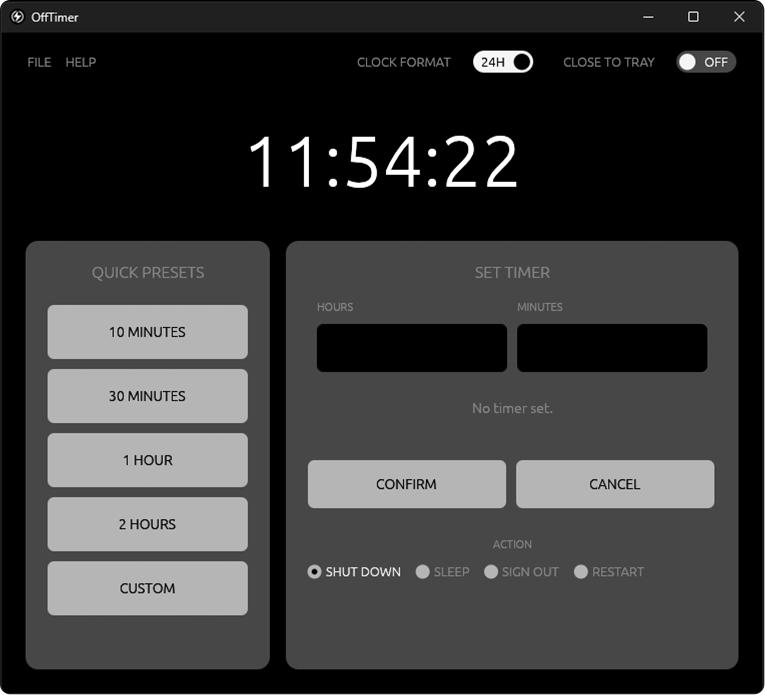
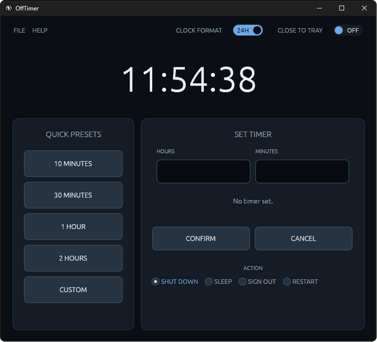
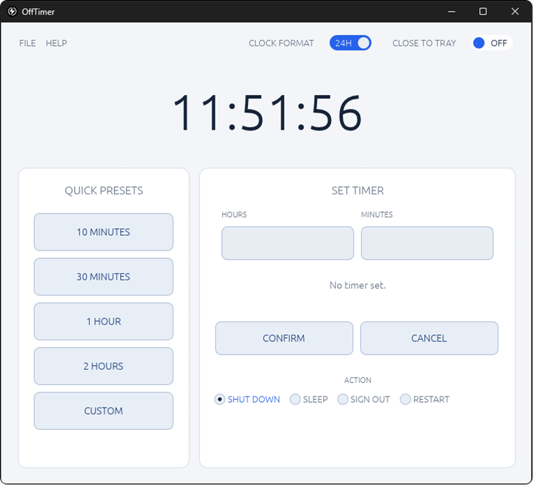
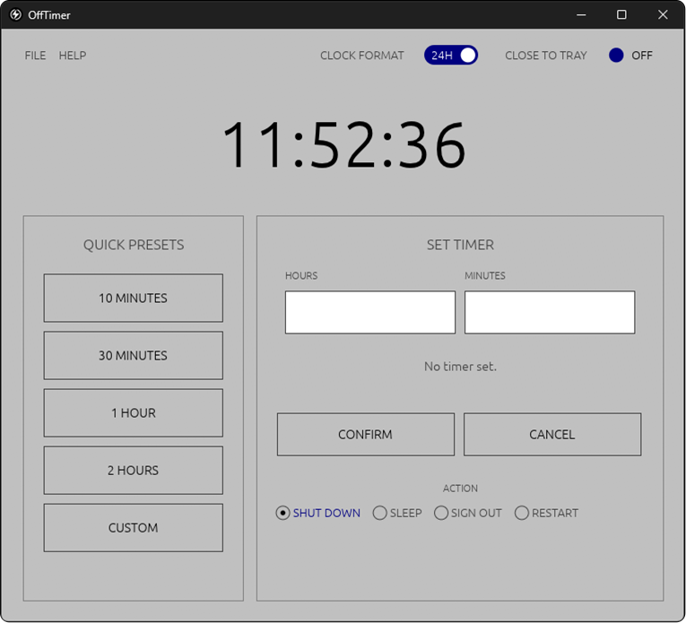
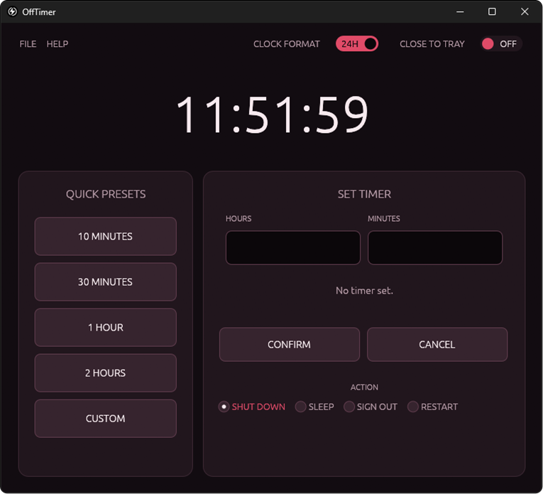

# OffTimer

**OffTimer** is a lightweight Windows desktop application for scheduling automatic shutdown, sleep, sign-out, and restart.

It combines a live clock, customizable quick presets, manual timer configuration, and a real-time countdown in a compact dark interface.

OffTimer uses native Windows system APIs to perform power actions. It does not require an account, an online service, or a background scheduling service.

<table>
  <tr>
    <td rowspan="2" align="center">
      
    </td>
    <td align="center">
      
    </td>
    <td align="center">
      
    </td>
  </tr>
  <tr>
    <td align="center">
      
    </td>
    <td align="center">
      
    </td>
  </tr>
</table>

## Download the latest version from the [Releases page](https://github.com/Amel-Okicic/OffTimer/releases/latest).

## Features

- Four built-in quick presets with independent customization.
- A separate customizable CUSTOM preset.
- Manual timer configuration using hours and minutes.
- Four selectable system actions: Shut Down, Sleep, Sign Out, and Restart.
- Live clock with 12-hour and 24-hour display formats.
- Real-time countdown display.
- Timer cancellation.
- Optional Close to Tray functionality.
- Automatic timer cancellation after system sleep or hibernation.
- Windows-native shutdown and restart countdowns.
- Single-instance application behavior.
- Five selectable visual themes: DEFAULT, MIDNIGHT, LIGHT, RED MOON, and WINDOWS CLASSIC.
- Native Windows application icon.

## 1. Application Interface

OffTimer uses a resizable desktop window with an initial size of **760 × 660 pixels** 
The interface is divided into two main sections:

| Section | Width |
|---|---:|
| QUICK PRESETS | 35% |
| SET TIMER | 65% |

The interface also includes a header with a large live clock and a top control bar.

### Top Controls

**FILE menu**
- THEME — opens the submenu for DEFAULT, MIDNIGHT, LIGHT, RED MOON, and WINDOWS CLASSIC. The active theme is highlighted with its accent color.
- EXIT — closes OffTimer.

**HELP menu**
- ABOUT OFFTIMER — displays the application information and version.

**CLOCK FORMAT**
- 24H — displays the clock in 24-hour format.
- 12H — displays the clock in 12-hour format, including AM/PM.

Changing the clock format affects the live clock display only. It does not change timer durations.

**CLOSE TO TRAY**
- ON — closing the main window hides OffTimer in the Windows notification area.
- OFF — closing the main window exits the application.

When hidden, clicking the OffTimer tray icon restores the main window.

The FILE → EXIT command always exits the application, even when Close to Tray is enabled.

---

## 2. QUICK PRESETS

The QUICK PRESETS panel provides five buttons for quickly configuring a timer.

Four presets have predefined initial durations:

| Preset | Default Duration |
|---|---:|
| 10 MINUTES | 10 minutes |
| 30 MINUTES | 30 minutes |
| 1 HOUR | 1 hour |
| 2 HOURS | 2 hours |
| CUSTOM | empty initial configuration |

### Selecting a Preset

Left-clicking a preset copies its configured duration into the HOURS and MINUTES fields in SET TIMER.

Selecting a preset does not start the timer. The user must still press CONFIRM.

### Customizing Individual Quick Presets

Each of the four built-in quick presets can be customized independently.

Right-click any preset button to open its customization dialog.

The dialog contains:
- HOURS input field.
- MINUTES input field.
- SAVE button.
- CANCEL button.

The editor is initially populated with that preset's current duration.

After saving:
- Only the selected preset is changed.
- Its button label displays the updated duration.
- The other presets remain unchanged.
- Left-clicking the button applies the new duration.
- Right-clicking it again opens the editor with the saved value.

Customized labels use a compact format, for example:

- 45 MIN
- 1 H
- 1 H 30 MIN
- 3 H

Saving the original default duration restores the original preset label.

### CUSTOM Preset

CUSTOM is an additional configurable preset.

When it has not yet been configured, left-clicking CUSTOM opens the customization dialog.

After saving, the button displays the configured duration.

Once configured:
- Left-clicking CUSTOM applies its saved duration to SET TIMER.
- Right-clicking CUSTOM opens the editor again.
- The editor is populated with the previously saved duration.

Preset customization is saved automatically in `%APPDATA%\OffTimer\settings.json` and restored the next time OffTimer starts. The file is created automatically on first launch. 

A tooltip appears when hovering over a preset button, explaining that right-click opens customization.

---

## 3. SET TIMER

The SET TIMER panel allows the user to specify a duration manually.

It contains two input fields:

| Field | Allowed Input |
|---|---|
| HOURS | Whole numbers, up to 999 |
| MINUTES | Whole numbers, from 0 to 59 |

The fields accept non-negative whole numbers only.

Blank fields are treated as zero. For example:
- HOURS = 1, MINUTES = blank → 1 hour.
- HOURS = blank, MINUTES = 15 → 15 minutes.
- Both fields blank or zero → invalid duration.

The maximum supported duration is **999 hours and 59 minutes**.

Invalid values are rejected and an explanatory error is displayed.

### CONFIRM

Pressing CONFIRM starts the countdown using:
- The duration in the HOURS field.
- The duration in the MINUTES field.
- The currently selected ACTION.

Pressing ENTER while either timer input field is focused also starts the timer.

Starting a timer does not immediately execute the selected system action.

### CANCEL

CANCEL stops the active timer.

When successfully cancelled:
- The countdown is stopped.
- The pending action is cleared.
- The HOURS and MINUTES fields are cleared.
- Any temporary OffTimer notification is removed.
- A cancellation message is displayed.

If a Windows-native shutdown or restart countdown has already started, OffTimer first attempts to cancel it through the Windows API. If Windows refuses the cancellation, an error is displayed and the application preserves the pending countdown state so the user can retry.

---

## 4. ACTION Selection

The ACTION section contains four mutually exclusive options.

Only one action can be selected at a time.

### SHUT DOWN

Schedules Windows to shut down the computer when the countdown expires.

During the final minute, OffTimer starts a Windows-native shutdown countdown. Windows displays its own countdown notification.

### SLEEP

Requests standard Windows sleep when the countdown reaches zero.

This is a sleep request, not a hibernation request.

A notification is sent during the final minute to inform the user that sleep is scheduled.

### SIGN OUT

Signs out the current Windows user when the countdown reaches zero.

A notification is sent during the final minute to inform the user that sign-out is scheduled.

### RESTART

Schedules Windows to restart the computer when the countdown expires.

During the final minute, OffTimer starts a Windows-native restart countdown. Windows displays its own countdown notification.

---

## 5. Countdown Behavior

OffTimer displays the remaining time in:

**HH:MM:SS**

The countdown updates continuously while the timer is active.

The selected action is shown below the countdown.

While a timer is running:
- HOURS and MINUTES inputs are disabled.
- QUICK PRESETS buttons are disabled.
- ACTION selection is disabled.
- CONFIRM is disabled.
- CANCEL remains available.

### Windows-Native Countdown

Shutdown and Restart use a special handoff mechanism.

When 60 seconds or less remain, OffTimer asks Windows to begin its native shutdown or restart countdown.

This means:
- Windows displays its own final countdown.
- Windows takes ownership of the final shutdown or restart sequence.
- OffTimer keeps its CANCEL functionality available to attempt to abort the native countdown.

OffTimer does not forcibly close applications or suppress normal unsaved-work prompts.

Once the native Windows countdown has started, closing OffTimer does not guarantee that the scheduled shutdown or restart will be cancelled.

### Sleep and Sign Out

Sleep and Sign Out are executed directly by OffTimer when the configured countdown reaches zero.

During the final minute, OffTimer sends a notification through the Windows notification area.

The notification identifies the pending action and provides an approximate remaining time.

For these two actions, OffTimer must remain running until the countdown finishes.

---

## 6. Sleep and Hibernation Detection

OffTimer monitors Windows system time to detect whether the computer has entered sleep or hibernation.

When the computer resumes:
1. OffTimer checks how much time was spent suspended.
2. If a real sleep or hibernation period is detected while a timer is active, the timer is cancelled.
3. Pending notifications are removed.
4. The user receives a status message explaining that the timer was cancelled.

If a Windows-native shutdown or restart countdown had already started, OffTimer also attempts to abort that countdown.

If Windows refuses the cancellation, OffTimer displays an error and retains the ability to retry cancellation manually.

This prevents an active application timer from unexpectedly executing an overdue action after the computer wakes up.

---

## 7. Saved Preferences

OffTimer stores the following preferences in `%APPDATA%\OffTimer\settings.json`:

- 12-hour or 24-hour clock format.
- Close to Tray enabled or disabled.
- The selected system action.
- The selected application theme (including RED MOON).
- The four customized quick-preset durations and the CUSTOM preset duration.

The settings file is updated when a preference changes. Timer input fields, active countdowns, and pending system actions are intentionally not restored after a restart.

## 8. Close to Tray

Close to Tray allows OffTimer to remain active without keeping its main window visible.

When enabled:
- Clicking the window's X button hides the main window.
- The OffTimer process remains running.
- Active timers continue running.
- A tray icon remains available.
- Clicking the tray icon restores the main window.

When disabled, closing the window exits OffTimer.

The FILE → EXIT command always terminates the application.

---

## 9. Single-Instance Protection

OffTimer allows only one running instance per Windows session.

When the user launches OffTimer while another instance is already running:
- A second application instance is not created.
- The existing window is restored if minimized or hidden.
- OffTimer attempts to bring the existing window to the foreground.

This prevents multiple OffTimer instances from independently scheduling system actions.

---

## 10. Important Behavior and Limitations

**The application must remain running.**

OffTimer does not install a Windows background service or create a persistent scheduled task.

Before the Windows-native shutdown or restart countdown is started, the timer is managed by OffTimer. Exiting the application at that stage stops the application-managed timer.

After Windows has accepted a native shutdown or restart countdown, that countdown belongs to Windows and may continue even if OffTimer exits.

Sleep and Sign Out require OffTimer to remain running until the configured time is reached.

**Preset customization is persistent.**

Changes to quick presets and CUSTOM are saved in `%APPDATA%\OffTimer\settings.json` and restored the next time OffTimer starts.

**No forced application closure.**

OffTimer does not use force-close flags for shutdown, restart, or sign-out. Windows and individual applications can handle unsaved work normally.

**Windows permissions.**

Windows must permit the requested system action. If the current account or system policy does not allow an operation, OffTimer displays an error instead of silently reporting success.

---

## 11. Build and Development

OffTimer is developed in Rust using:
- [egui](https://github.com/emilk/egui) — graphical user interface.
- [eframe](https://github.com/emilk/egui/tree/master/crates/eframe) — native desktop application framework.
- [chrono](https://github.com/chronotope/chrono) — local clock display.
- [windows-sys](https://github.com/microsoft/windows-rs) — native Windows system APIs.
- [tray-icon](https://github.com/tauri-apps/tray-icon) — notification-area icon.

The application icon is generated during the build from `icons/OffTimerIcon.svg`.

### Requirements

- Rust stable toolchain.
- Windows x64 environment for full application functionality.

## Project Structure

```text
OffTimer/
├── .github/
│   └── workflows/
│       ├── build.yml
│       └── tests.yml
├── icons/
│   └── OffTimerIcon.svg
├── src/
│   ├── actions.rs
│   ├── main.rs
│   └── settings.rs
├── build.rs
├── Cargo.toml
├── Cargo.lock
└── README.md
```

## About
Lightweight Windows app for scheduling shutdown, sleep, sign-out, and restart.

- `OffTimer-v1.0.0-windows-x64.zip`: extract and run `offtimer.exe`. No installer needed.

### Windows SmartScreen warning
This app is not code-signed, so Windows may show **"Windows protected your PC"** the first time you run it. This is normal for new, unsigned apps.

To run it:
1. Click **More info**.
2. Click **Run anyway**.

OffTimer is designed to provide a straightforward way to schedule common Windows power actions without unnecessary configuration or background services.
**Author:** [Amel Okicic](https://github.com/Amel-Okicic)

## Download 
Get the latest version from the [Releases page](https://github.com/Amel-Okicic/OffTimer/releases/latest).

